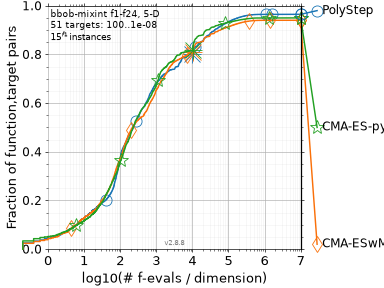
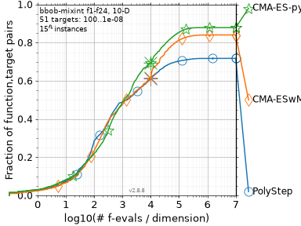

# Benchmarks

## bbob-mixint

COCO's [`bbob-mixint`](https://numbbo.github.io/coco/testsuites/bbob-mixint) suite
([Tušar et al., GECCO 2019](https://hal.inria.fr/hal-02067932)) has 24 functions where
80% of the variables are integers with 2 to 16 values. Plain CMA-ES often stalls on this
suite, because its step size becomes smaller than the integer grid. CMA-ES with margin
([Hamano et al., GECCO 2022](https://arxiv.org/abs/2205.13482)) prevents this with a lower
bound on the marginal probabilities. In PolyStep, the caller sets the radius. Here the
radius decreases geometrically, and the run restarts when the radius becomes too small.

We ran dimensions 5 and 10, instances 1-15, one run each, with a budget of `10^4 * dim`
evaluations. PolyStep used `PolyStepES` with the box bounds, a `repair` that rounds the
integer coordinates, a geometric radius decay and random restarts. We tuned its three
settings on dimension 20, which is not in the table: `epsilon = 0.1`, a start radius
equal to the mean box width, and decay 0.95. The two baselines are the archived COCO runs
of CMA-ES with margin (2022) and pycma (2019). We did not tune them.
[`benchmark/`](https://github.com/anindex/PolyStep.jl/tree/main/benchmark) contains all
files to run the experiment again.

The table gives the fraction of solved (function, instance, target) triples for 51
targets from `10^2` to `10^-8`, after `100`, `1000` and `10^4` evaluations per dimension:

| dim | group | PolyStep | CMA-ES with margin | CMA-ES (pycma) |
|---|---|---|---|---|
| 5 | all | .37 / .68 / .80 | .37 / .65 / .81 | .36 / .67 / .82 |
| 5 | separable | .52 / .83 / .89 | .62 / .87 / 1.0 | .55 / .91 / 1.0 |
| 5 | multimodal | .26 / .62 / .84 | .25 / .58 / .80 | .23 / .59 / .80 |
| 5 | multimodal, weak structure | .27 / .49 / .64 | .22 / .40 / .58 | .24 / .43 / .62 |
| 10 | all | .29 / .49 / .61 | .24 / .48 / .62 | .22 / .49 / .69 |
| 10 | separable | .45 / .59 / .78 | .46 / .77 / .85 | .31 / .75 / .90 |
| 10 | multimodal | .17 / .47 / .56 | .14 / .41 / .53 | .14 / .35 / .66 |
| 10 | multimodal, weak structure | .23 / .26 / .39 | .13 / .18 / .45 | .16 / .22 / .49 |

Up to `1000 * dim` evaluations, PolyStep solves approximately as many targets as the
better CMA-ES, or more. Most of its advantage comes from the multimodal functions. With
the full budget, it ties CMA-ES with margin. It is worse than pycma, by .02 in dimension 5
and by .08 in dimension 10. It is weakest on separable functions, where both CMA-ES
variants reach all targets in dimension 5. The results for the conditioning groups are
mixed, so the table does not include them. The script prints them.

This is a small pilot (15 runs per function and dimension), not a ranking. The plots are
the COCO runtime ECDFs. After the budget of each algorithm (the cross), cocopp extends the
curves with simulated restarts.

## Examples

The scripts in [`examples/`](https://github.com/anindex/PolyStep.jl/tree/main/examples)
compare PolyStep with tuned baselines on OR and decision-focused learning problems. The
[home page](index.md) gives their results.
